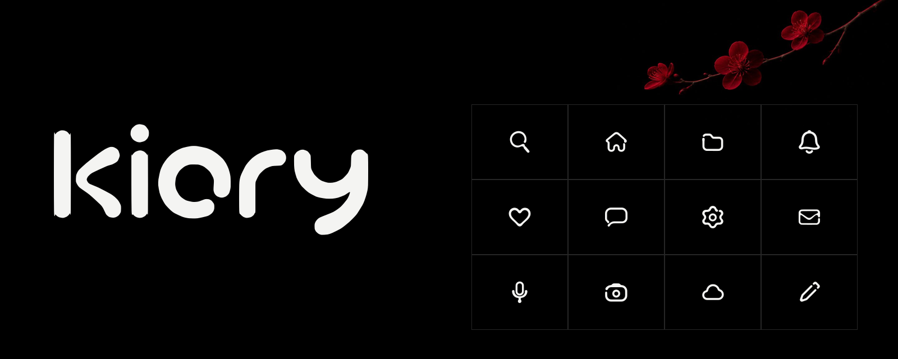

<p align="center"><picture>
<source media="(prefers-color-scheme: light)" srcset="docs/previews/cover-light.png">

</picture></p>

<p align="center">
<a href="https://zinzaki.github.io/kiory/"><b>Каталог</b></a> ·
<a href="#подключение">Подключение</a> ·
<a href="CHANGELOG.md">Изменения</a> ·
<a href="#лицензия">Лицензия</a>
</p>

<p align="center">


</p>

# Kiory

Мягкие интерфейсные иконки на точной сетке 24 × 24 из мастерской YHK. Шестнадцать разделов —
от навигации, файлов и окон до дизайна, 3D, кода, Linux и ИИ. Одна толщина линии во всех иконках,
залитые контуры, цвет берётся из текста.

| Раздел | Что внутри | Раздел | Что внутри |
| --- | --- | --- | --- |
| Путь | навигация и стрелки | Холст | вектор, токены, интерфейс |
| Жест | действия и буфер обмена | Ход | анимация, эффекты, 3D |
| Рама | окна, панели, тайлинг | Письмо | типографика и Markdown |
| Архив | файлы, папки, диски | Разум | ИИ, агенты и LLM |
| Механизм | система, железо, сеть | Верстак | код, Git, CI, DevOps |
| Замок | безопасность и ключи | Схема | данные, графики, ноды |
| Голос | люди, почта, боты | Звук | медиа, запись, синтез |
| Знак | статусы и реакции | Мир | время, места, погода, вещи |

## Каталог

**[zinzaki.github.io/kiory](https://zinzaki.github.io/kiory/)** — или откройте `index.html` из
репозитория, он работает без сервера.

- клик копирует иконку — SVG, JSX, CSS-класс или имя, на выбор;
- `Ctrl`/`⌘` + клик собирает набор, `Shift` + клик — диапазон; набор копируется разом или скачивается ZIP;
- поиск — просто начните печатать, понимает и русские слова;
- карточка иконки: все размеры, PNG до 512 px, data URI, ссылка на иконку;
- «Скачать всё» — весь пак архивом.

## Подключение

### Пакет

```sh
bun add github:zinzaki/kiory
pnpm add github:zinzaki/kiory
```

npm 12 по умолчанию не ставит пакеты из GitHub — нужен флаг `--allow-git=all`.

```jsx
import { KioryIcon } from 'kiory/react';

<KioryIcon name="search" size={20} />
```

```js
import { svg, names } from 'kiory';

button.innerHTML = svg('search', { size: 20 });
```

TypeScript подсказывает имена иконок.

### CSS без сборки

```html
<link rel="stylesheet" href="https://cdn.jsdelivr.net/gh/zinzaki/kiory@main/dist/kiory.css">

<i class="ki ki-search"></i>
```

Размер задаёт `font-size`, цвет — `color`.

### SVG и спрайт

Отдельные файлы лежат в [`dist/svg/`](dist/svg). Спрайт со всеми иконками:

```html
<svg width="24" height="24" aria-hidden="true"><use href="kiory.sprite.svg#kiory-search"/></svg>
```

### Что внутри `dist/`

| Файл | Для чего |
| --- | --- |
| `svg/*.svg` | отдельные иконки |
| `kiory.sprite.svg` | все иконки символами `kiory-<имя>` |
| `kiory.css` | классы `.ki .ki-<имя>` |
| `kiory.js`, `kiory.d.ts` | тела иконок, `svg()`, список имён, типы |
| `react.js`, `react.d.ts` | компонент `KioryIcon` |
| `kiory.json` | имя, раздел, теги, даты появления и обновления, тело |

Базовый размер — 24 px, рабочий — 20 px. Плотные иконки (`qr-code`, `cpu`, `fingerprint`,
`face-id`) лучше не уменьшать до 16 px.

Как добавить или заменить иконку — в [CONTRIBUTING.md](CONTRIBUTING.md).

## Лицензия

[PolyForm Small Business 1.0.0](LICENSE). Коротко (юридически действует только текст лицензии):

- **бесплатно** для частных лиц, некоммерческих и учебных проектов, а также компаний, где меньше
  100 человек и выручка за прошлый год меньше ~1 млн USD;
- **крупным компаниям** нужна коммерческая лицензия — напишите автору через
  [GitHub](https://github.com/zinzaki);
- передавая иконки дальше, сохраняйте текст лицензии и строку `Required Notice`.

Шрифты каталога — Geologica и JetBrains Mono, лицензия SIL OFL ([`fonts/`](fonts)).
Фотографии ветвей и лепестков в [`art/`](art) — только оформление каталога и README, в пак иконок они не входят.
