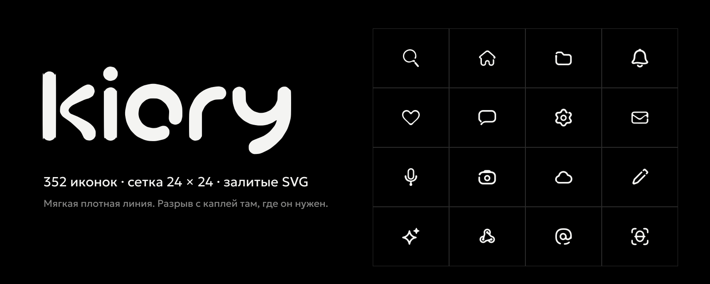

<p align="center"></p>

# Kiory

Авторский пак интерфейсных иконок. Одна толщина и один материал: мягкая плотная линия,
скругления без острых углов, разрыв с каплей там, где он улучшает форму. Пак вырос из одной
лупы ([`reference/эталоны/kiory-search-white.svg`](reference/эталоны/kiory-search-white.svg)) и метки
под глазом персонажа Айви.

**352 SVG · 13 семейств · сетка 24 × 24 · `currentColor` · без зависимостей**

<p align="center">


</p>

## Каталог

Открой [`index.html`](index.html) — он работает без сервера и без сборки, а на GitHub Pages
публикуется сам при каждом пуше в `main`.

- **клик** по иконке копирует её SVG (или имя, или `<use>` для спрайта — переключатель в панели);
- **Ctrl/⌘ + клик**, галочка на плитке или режим выбора — собрать несколько иконок, затем
  скопировать их разом или скачать ZIP; **Shift + клик** выбирает диапазон, «выбрать семейство» — всё семейство;
- **«Весь пак, ZIP»** — все SVG, спрайт и файл с уведомлением о лицензии;
- поиск по `/` понимает и русские слова: «папка», «колокольчик», «нейросеть»;
- размеры 16–40 px, цвет превью, светлая и тёмная тема, карточка иконки со всеми размерами и кодом.

[Все иконки на тёмном](docs/previews/all-24-dark.png) · [на светлом](docs/previews/all-24-light.png) ·
[16 px](docs/previews/all-16-dark.png) · превью по семействам — в [`docs/previews/`](docs/previews)

## Использовать

Файлы лежат в `icons/`. Чтобы иконка брала цвет текста, вставляй SVG в разметку, а не через ``:

```html
<button aria-label="Поиск">
  <!-- содержимое icons/search.svg, к корню добавить aria-hidden="true" -->
</button>
```

Или спрайтом (на сайте, который отдаётся по HTTP):

```html
<svg width="24" height="24" aria-hidden="true"><use href="kiory.sprite.svg#kiory-search"/></svg>
```

Базовый размер — 24 px, рабочий — 20 px. Плотные иконки (`qr-code`, `cpu`, `fingerprint`, `face-id`)
лучше не уменьшать до 16 px.

## Что где

| Путь | Что это |
| --- | --- |
| `icons/` | 352 готовых SVG — сам пак |
| `families.json` | 13 семейств и порядок иконок в них — источник правды для сборки |
| `groups.json` | рабочие группы по смыслу (рисование, файлы, ИИ…) |
| `manifest.json` | машиночитаемый индекс: имя, семейство, файл, теги |
| `kiory.sprite.svg` | все иконки символами `kiory-<имя>` |
| `index.html` | автономный каталог, собирается из `scripts/gallery.html`, публикуется на Pages |
| `brand/` | логотип Kiory |
| `fonts/` | шрифты каталога Geologica и JetBrains Mono (OFL) |
| `docs/` | превью, история пака, аудит v7 |
| `reference/` | эталоны автора, пак v6, файл отбора v7 |
| `scripts/` | сборка и проверка |
| `archive/` | черновики, движок и мастерская прошлых этапов (в git не входит) |

## Сборка

Нужен Python 3.11+, для PNG-превью — `rsvg-convert` (librsvg).

```sh
python3 scripts/build.py           # проверка, manifest, спрайт, index.html, превью
python3 scripts/build.py --check   # только проверка
```

Добавляешь иконку: кладёшь `icons/<имя>.svg` (24 × 24, только залитые `path` c `currentColor`),
вписываешь имя в нужное семейство в `families.json`, запускаешь сборку.

## Лицензия

[PolyForm Small Business 1.0.0](LICENSE). Коротко (юридически действует только текст лицензии):

- **Бесплатно** для частных лиц, некоммерческих и учебных проектов, а также компаний, где меньше
  100 человек (сотрудники и подрядчики вместе) и выручка за прошлый год меньше ~1 млн USD.
- **Крупным компаниям** нужна отдельная коммерческая лицензия — напишите автору через
  [GitHub](https://github.com/zinzaki).
- Передавая иконки дальше, сохраняйте текст лицензии и строку `Required Notice`.
