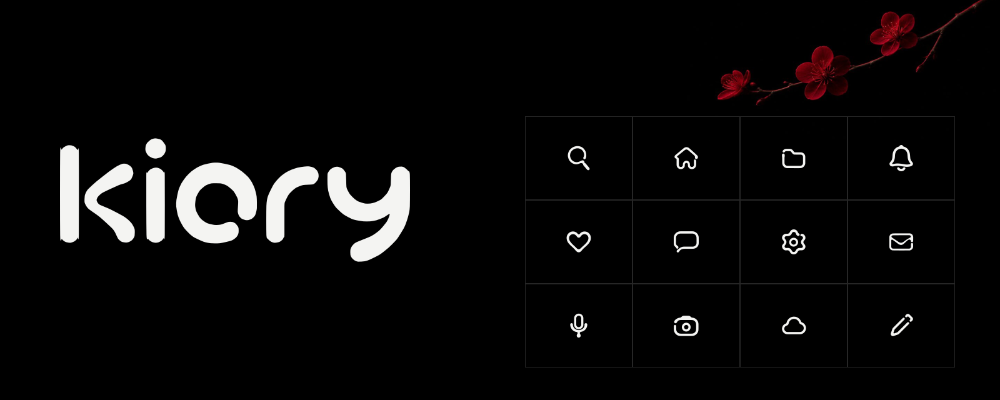

<p align="center"><picture>
<source media="(prefers-color-scheme: light)" srcset="docs/cover-light.png">

</picture></p>

<p align="center">
<a href="https://zinzaki.github.io/kiory/"><b>Catalog</b></a> ·
<a href="#install">Install</a> ·
<a href="CHANGELOG.md">Changelog</a> ·
<a href="#license">License</a>
</p>

# Kiory

Soft interface icons on a precise 24 × 24 grid, from the YHK Atelier. 725 icons in sixteen
sections, from navigation, files and windows to design, 3D, code, Linux and AI. One line weight
across the whole pack, filled outlines, and the colour comes from the text.

| Section | Inside | Section | Inside |
| --- | --- | --- | --- |
| Path | navigation and arrows | Canvas | vectors, tokens, interface |
| Gesture | actions and clipboard | Motion | animation, effects, 3D |
| Frame | windows, panels, tiling | Script | typography and Markdown |
| Archive | files, folders, drives | Mind | AI, agents and LLMs |
| Mechanism | system, hardware, network | Workbench | code, Git, CI, DevOps |
| Lock | security and keys | Schema | data, charts, node graphs |
| Voice | people, mail, bots | Sound | media, recording, synthesis |
| Sign | status and reactions | World | time, places, weather, objects |

## Catalog

**[zinzaki.github.io/kiory](https://zinzaki.github.io/kiory/)**, or open `index.html` from the
repository: it works without a server.

- hover the icon field on the first screen: the lens magnifies and names every icon, a click copies it;
- a click in the catalog copies the icon as SVG, JSX, a CSS class or its name;
- `Ctrl`/`⌘` + click builds a set, `Shift` + click adds a range; copy the set at once or download a ZIP;
- search from anywhere on the page, just start typing;
- the icon card has every size, PNG up to 512 px, a data URI and a link to the icon;
- "Download all" gets the whole pack as a ZIP.

## Install

### Package

```sh
bun add github:zinzaki/kiory
pnpm add github:zinzaki/kiory
```

npm 12 skips packages from GitHub by default; pass `--allow-git=all`.

```jsx
import { KioryIcon } from 'kiory/react';

<KioryIcon name="search" size={20} />
```

```js
import { svg, names } from 'kiory';

button.innerHTML = svg('search', { size: 20 });
```

TypeScript suggests the icon names.

### CSS without a build step

```html
<link rel="stylesheet" href="https://cdn.jsdelivr.net/gh/zinzaki/kiory@main/dist/kiory.css">

<i class="ki ki-search"></i>
```

`font-size` sets the size, `color` sets the colour.

### SVG and sprite

Individual files live in [`dist/svg/`](dist/svg). The sprite holds every icon:

```html
<svg width="24" height="24" aria-hidden="true"><use href="kiory.sprite.svg#kiory-search"/></svg>
```

### What is in `dist/`

| File | For |
| --- | --- |
| `svg/*.svg` | individual icons |
| `kiory.sprite.svg` | every icon as a `kiory-<name>` symbol |
| `kiory.css` | `.ki .ki-<name>` classes |
| `kiory.js`, `kiory.d.ts` | icon bodies, `svg()`, the name list, types |
| `react.js`, `react.d.ts` | the `KioryIcon` component |
| `kiory.json` | name, section, tags, added and updated dates, body |

The base size is 24 px, the working size 20 px. Dense icons (`qr-code`, `cpu`, `fingerprint`,
`face-id`) are better kept above 16 px.

To add or replace an icon, see [CONTRIBUTING.md](CONTRIBUTING.md).

## License

[PolyForm Small Business 1.0.0](LICENSE). In short (only the license text is legally binding):

- **free** for individuals, non-profit and educational projects, and companies with fewer than
  100 people and under roughly USD 1 million in revenue last year;
- **larger companies** need a commercial license; reach the author through
  [GitHub](https://github.com/zinzaki);
- when you pass the icons on, keep the license text and the `Required Notice` line.

The catalog uses Geist and Geist Mono by Vercel, licensed under the SIL OFL ([`fonts/`](fonts)).
Photographs of branches and petals in [`art/`](art) are only for the catalog and this README;
they are not part of the icon pack.
